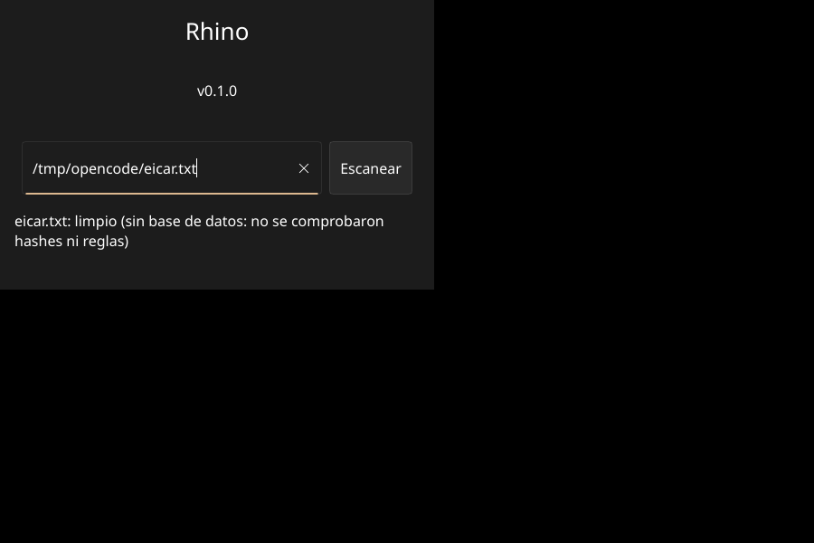

# Rhino

Antivirus ligero, rápido y de bajo consumo para Windows, con interfaz intuitiva y gratuito.

## Principio rector

La eficiencia es la característica principal, no una optimización posterior. Rhino debe
ser prácticamente imperceptible en un equipo modesto: **la restricción dura es el consumo
de memoria y de CPU**, no el tamaño. Sin picos de CPU, sin consumo excesivo de RAM y sin
ralentizar el sistema. La funcionalidad se inspira en lo mejor de los antivirus
reconocidos, pero sin su peso.

**El tamaño de los binarios y del paquete de datos no es una restricción.** Un antivirus
potente y de bajo consumo no cabe en 3 MB, y recortar peso a costa de capacidad de
detección sería el error contrario. Lo que no se cruza es la memoria en uso y el tiempo de
CPU; el consumo medido se anota en "Motor de detección y base de datos".

## Plataforma objetivo

- **Mínimo:** Windows 10 de 32 bits (x86) con **4 GB de RAM**.
- **También soportado:** Windows 10/11 de 64 bits (x64).
- **Desarrollo:** Ubuntu, con compilación cruzada hacia Windows.

Los 4 GB son la base de desarrollo (provisional, octubre de 2026). Son el suelo, no un
techo: el punto está en no apuntar cada decisión a equipos de 1 GB, que ya no corresponden a
las máquinas reales y estrangularían el antivirus.

El consumo de **100 a 200 MB** es solo una referencia de trabajo, no un límite: se irá
ajustando a medida que el software crezca, con las mediciones de la sección "Consumo medido"
como punto de partida. Ninguna decisión de diseño se descarta por no caber en esa cifra.

En 32 bits conviene recordar que el sistema operativo solo ve unos 3,2 GB de esos 4 GB y
que **un proceso de 32 bits dispone de ~2 GB de espacio de direcciones**, del que también
sale el archivo mapeado.

### Política de arquitectura

Se diseña **32 bits primero**. Los límites de x86 (espacio de direcciones de 2-3 GB,
`usize` de 32 bits, archivos que no se pueden mapear completos en memoria) son la
línea base, y x64 es un superconjunto de esos límites.

Todo el código específico de arquitectura o de Windows vive en un único módulo
`platform`; el núcleo (motor de firmas, hashes, lógica de escaneo) es agnóstico. La
base de firmas es neutral respecto a la arquitectura y está versionada.

Así, abandonar x86 en una versión futura (planificado para una eventual 2.0, dejando
la última compilación de 32 bits funcionando sin actualizaciones) se reduce a: quitar
el target i686 de la CI, congelar el canal de actualización de 32 bits y borrar el
módulo `platform`. Sin tocar el núcleo.

## Alcance

**Solo modo usuario (user-mode).** Nada de kernel por ahora: ni minifiltros, ni
drivers. Es delicado, requiere firma de drivers y su propio ciclo de desarrollo, y
no aporta al objetivo de eficiencia en esta etapa. Es un tema que podría tocarse muy
a futuro, pero no condiciona ninguna decisión actual.

La protección en tiempo real (Fase 5) se plantea con las capacidades de modo usuario
disponibles, sin driver.

## Privacidad

**Nada sale del equipo.** Rhino no envía rutas, nombres de archivo, contenido ni
telemetría, ni siquiera anónima. Lo único que cruza la red es la descarga del paquete
de firmas; de todo lo que Rhino conoce, lo único que expone es lo que ese paquete
identifica (su versión y su canal).

Un antivirus que reporta lo que el usuario tiene en su disco es justo lo que este
proyecto no quiere ser, y es también la razón por la que muchos usuarios desconfían
de los antivirus comerciales.

## Lenguaje: Rust

Elegido sobre Go por cuatro razones que atacan directo los objetivos del proyecto:

1. **Eficiencia real:** memoria segura sin recolector de basura. No hay pausas
   *stop-the-world*, lo que importa en un servicio que escanea archivos en tiempo real.
   Huella y latencia predecibles.
2. **Resistencia a ingeniería inversa:** un binario Rust con `strip` + LTO pierde casi
   toda su metadata. Go reconstruye nombres de funciones y tipos desde su propia
   metadata de runtime, lo que facilita revertir el binario. Rust eleva la barrera de
   los intentos más básicos.
3. **Ecosistema de seguridad nativo:** [YARA-X](https://github.com/VirusTotal/yara-x)
   (reescritura de YARA hecha en Rust por VirusTotal, madura y en producción) es el
   motor de firmas de facto y ya está en Rust. Con Go habría que usar CGo, que complica
   la compilación cruzada.
4. **Acceso a Windows:** [`windows-rs`](https://github.com/microsoft/windows-rs), de
   Microsoft, da bindings seguros a toda la API Win32. Y a diferencia de Go, Rust puede
   escribir drivers de kernel (minifiltros) si una fase futura lo requiere.

## Motor de detección y base de datos

**El motor de patrones no se escribe desde cero.** Es
[YARA-X](https://github.com/VirusTotal/yara-x) (licencia BSD-3-Clause), la reescritura
de YARA en Rust que VirusTotal tiene en producción escaneando miles de millones de
archivos. Lo propio de Rhino es el orquestador de escaneo, el formato del paquete de
base de datos, el actualizador, la heurística propia y la interfaz.

### Capas de detección

Las firmas son solo una de varias capas:

| Capa | Qué detecta | Coste | Depende de |
| --- | --- | --- | --- |
| 1. Hash exacto | Malware ya conocido (IOC) | Muy bajo | Listas de hashes |
| 2. Firmas YARA-X | Familias, herramientas de ataque, webshells, exploits | Bajo | YARA Forge |
| 3. Heurística propia | PE anómalo, packers, entropía alta, macros sospechosas | Medio | Solo Rhino |
| 4. Comportamiento (futuro) | Acciones en ejecución, en modo usuario | — | Solo Rhino |
| 5. ML / reputación (futuro) | — | — | — |

La capa 3 es la diferencia real: es la única donde Rhino aporta detección propia y no
depende de terceros.

### De dónde salen las firmas

De **YARA Forge** ([`YARAHQ/yara-forge`](https://github.com/YARAHQ/yara-forge)), un
proyecto que recolecta reglas de más de 45 repositorios de seguridad, las normaliza, las
prueba contra falsos positivos, las puntúa (0–100) y publica **paquetes semanales** en
tres niveles: `core` (alta calidad, bajo falso positivo), `extended` y `full`. Es lo que
usan productos comerciales como THOR.

Un trabajo automático en la CI haría el resto: descargar el release semanal, filtrar las
reglas con licencia copyleft, compilar con `yr compile`, armar el paquete, firmarlo y
publicarlo. Sin trabajo manual y sin laboratorio de malware propio.

### Licencias

Se consumen **solo fuentes permisivas**: YARA Forge `core` (mezcla de DRL 1.1, BSD y
Apache 2.0), y repositorios como Signature Base y SEKOIA.IO (DRL 1.1, que permite el uso
comercial con atribución). Quedan descartadas las reglas GPL (Yara-Rules/rules, CAPE
Sandbox) y la base de datos de ClamAV (GPL), que obligarían a que todo Rhino fuese GPL y
enredarían la compatibilidad con Slint (GPLv3 o comercial).

Esto mantiene a Rhino libre para ser abierto o cerrado cuando se decida.

**Consecuencia obligatoria:** la licencia DRL 1.1 exige que el mensaje de detección
nombre al autor de la regla. La interfaz debe poder mostrar *"Detectado por la regla X,
autor Y, fuente Z"*.

### Paquete de base de datos

```
rhino-db-AAAA.MM.DD/
  manifest.json   versión, fecha, canal, conteos y hash de cada archivo
  rules.yarc      reglas YARA-X precompiladas
  hashes.bin      hashes conocido-malo (capa 1)
  manifest.sig    firma Ed25519 del manifest
```

No hay `meta.json` a propósito: los metadatos por regla (autor, `source_url`) viajan dentro
de las reglas compiladas y el motor los devuelve con cada coincidencia, así que la
atribución que exige DRL 1.1 ya queda satisfecha sin duplicarlos en un archivo aparte.

`hashes.bin` tampoco depende de un feed externo: las reglas de YARA Forge declaran en su
metadato `hash` los hashes de las muestras contra las que se escribieron, y de ahí se extrae
la lista (más el EICAR).

Las reglas se compilan **una sola vez, en la CI**, nunca en el equipo del usuario: compilar
miles de reglas al arrancar cuesta segundos y unos 180 MB de memoria en una máquina modesta,
mientras que cargar el archivo precompilado cuesta unos 52 MB. El paquete va firmado con
Ed25519 (clave pública dentro de Rhino, privada solo en los secretos de la CI): sin esa
firma, quien intercepte una actualización podría apagar el antivirus. Además de la firma,
`load()` comprueba el tamaño y el SHA-256 de cada archivo antes de usarlo.

El paquete es neutral respecto a la arquitectura; el manifiesto ya lleva el campo `channel`,
para que los canales por arquitectura solo necesiten transporte.

**Cómo se construye y se verifica.** El crate `rhino-db` es la herramienta del workspace:

```sh
cargo run -p rhino-db -- keygen <clave-privada>    # una sola vez; la privada nunca va al repositorio
cargo run -p rhino-db -- build --rules <yara-rules-core.yar> --out <dir> \
                              --channel stable --key <clave-privada>
cargo run -p rhino-db -- verify --package <dir> [--public-key <hex>]
```

`build` compila, firma y **verifica su propia firma antes de escribir nada**.

Medición real del paquete `core` (octubre de 2026): **5137 reglas y 1939 hashes**: compilar
tarda unos 34 s (una vez por semana, en la CI) y el paquete ocupa 8,5 MB de reglas más 0,1 MB
de hashes.

La clave de producción ya está puesta: `DB_PUBLIC_KEY` en `db.rs` lleva la real, y su mitad
privada vive en `~/.config/rhino/db-key` (fuera del repositorio, con permisos 600). Es el
único secreto del proyecto: quien la tenga puede emitir un paquete que apague Rhino en todos
los equipos.

### Consumo medido

Ruta de producción (`.yarc`, `RuleSet::from_compiled`), con el paquete `core` completo,
medido con `/usr/bin/time -v`:

| Escenario | RAM máxima |
| --- | --- |
| Capas 1 y 3, sin reglas | 11 MB |
| Con las 5137 reglas cargadas | 63 MB |
| Más un archivo de 512 MB | 115 MB |
| Compilando esas reglas en el equipo del usuario | 238 MB |

El conjunto cargado ocupa unos **52 MB**, y ahí está el argumento definitivo para
precompilar en la CI: hacerlo en el equipo del usuario no solo cuesta segundos, cuesta
unos 180 MB más de RAM. Los archivos grandes se leen con memoria mapeada (por encima de
32 MB), que es paginada del sistema de archivos y el sistema operativo puede reclamar: no
presiona la memoria como lo haría un `Vec`.

Escanear `/usr/bin` (2394 archivos) tarda 26 s con reglas y 9 s sin ellas.

El peor caso medido es de 115 MB. Es la cifra que sirve de referencia mientras el software
crece; no es un tope que haya que respetar.

### Actualizador

`rhino_core::update` descarga un paquete publicado y lo instala:

```sh
cargo run -p rhino-db -- update <url> <directorio>
```

La aplicación lee la base de datos del perfil del usuario, no de la carpeta del
programa: `%LOCALAPPDATA%\Rhino\rhino-db` en Windows y
`~/.local/share/Rhino/rhino-db` (o `$XDG_DATA_HOME/Rhino/rhino-db`) en el resto. Para
probar contra el sitio local:

```sh
cargo run -p rhino-db -- update http://localhost:27182/db/stable ~/.local/share/Rhino/rhino-db
```

El módulo **solo descarga**: quien tiene autoridad para aceptar un paquete es `db::Package`
con la firma Ed25519, no el código que habla por la red. De ahí el reparto: `update` baja
primero `manifest.json` y `manifest.sig`, comprueba la firma, y **solo si la versión es
distinta** se molesta en bajar los 8,5 MB de reglas.

El reemplazo es por directorio completo, nunca archivo a archivo. El paquete nuevo se arma en
`rhino-db.nuevo` y se verifica entero (firma más SHA-256 de cada archivo); solo entonces se
intercambia con el instalado, que queda como `rhino-db.anterior` y se borra. Si el intercambio
falla a mitad, el paquete viejo vuelve a su sitio. Nunca existe un estado intermedio.

La URL base se configura con la variable de entorno `RHINO_DB_URL` (`update::configured_url()`)
porque todavía no hay servidor público: el sitio que aloja los paquetes vive en `web/`.

### Robustez

El motor come archivos que el usuario no escribió, y la historia de ClamAV lo dice con
claridad: casi todos sus CVE críticos son parsers de formato y descompresores que caen o se
salen de los límites con una entrada manipulada, no fallos del motor de firmas. Rust cierra la
corrupción de memoria, que es la mayoría de esos casos, pero no el pánico, el desbordamiento
silencioso ni el bucle infinito.

Tres defensas, de dentro hacia fuera:

- **Lecturas acotadas.** El lector PE lee solo cabeceras y como mucho 96 secciones, aunque la
  cabecera declare otra cosa. Ninguna capa carga el archivo entero en memoria.
- **Pruebas de propiedad** (`proptest`, solo como dependencia de desarrollo, así que no entra
  en el binario): bytes arbitrarios y ejecutables válidos mutados no pueden hacer entrar en
  pánico al lector, y el veredicto nunca puede decir «limpio» mientras un hallazgo diga otra
  cosa.
- **Aislamiento del pánico.** El perfil de release usa `unwind` a propósito y cada archivo se
  analiza dentro de `scan::isolate`: uno que haga caer al motor se reporta como *no analizado*
  (sospechoso) en vez de llevarse por delante el escaneo entero. Un archivo que no se pudo
  mirar nunca se reporta como limpio.

## Interfaz gráfica: Slint

Elegida sobre `egui`, `iced` y las alternativas basadas en web:

- Se compila AOT a código nativo: sin intérprete, sin webview y sin recolector de basura.
- Tiene **renderizador por software** (CPU, sin GPU ni OpenGL), ideal para equipos
  modestos o con drivers gráficos malos. Se fuerza con `SLINT_BACKEND=winit-software`.
- Su huella es mínima (el framework está diseñado para embebidos).
- Es gratis para aplicaciones de escritorio (licencia *royalty-free*; también
  disponible bajo GPLv3 o comercial).

Descartadas: `egui` (modo inmediato, redibuja de más y requiere OpenGL), `iced`
(requiere GPU) y Tauri/Electron (meten un motor de navegador en RAM, contra el objetivo
de eficiencia).

La interfaz vive en su propio crate (`rhino-app`), desacoplada del núcleo
(`rhino-core`), para poder cambiarla sin tocar la lógica.

La ventana mide 480x320 y hoy solo tiene un campo de ruta y un botón; la interfaz de verdad
es la Fase 4.



## Pruebas

- **Unitarias:** obligatorias. Con `#[test]`, junto al código, vía `cargo test`.
- **De integración:** en `tests/`, para la lógica que cruza módulos.
- **End-to-end (e2e):** se entienden como pruebas de integración que ejecutan el motor
  completo sobre un corpus de archivos (benignos y maliciosos conocidos), no como
  automatización de la ventana gráfica. Automatizar la interfaz cuesta mucho y aporta
  poco; se omite por ahora.
- **Corpus sintético:** el módulo `rhino_core::corpus` genera en memoria las muestras que
  ejercitan cada capa (EICAR, PE empaquetado, sección ejecutable-escribible, PE truncado).
  Como Rhino es un escáner *estático* y nunca ejecuta lo que analiza, el proyecto **no
  necesita descargar ni almacenar malware real** para probar el motor.
- **Falsos positivos:** `cargo run -p rhino-core --example scan_dir -- <directorio> [reglas.yar|reglas.yarc]`
  mide la métrica que decide si un antivirus es usable. Con las capas 1 y 3: 0 detecciones
  sobre 2394 binarios de `/usr/bin`. Con el paquete real de YARA Forge (5137 reglas) sale
  **una**: la regla de *hacktool* «socat» marca a `socat1`, una herramienta legítima de
  doble uso. Un falso positivo de la clase esperable, no un fallo del motor.
- **Paquete firmado:** las pruebas cubren lo que de verdad importa de la base de datos:
  firma ausente, firma hecha con otra clave, manifiesto alterado después de firmar y archivo
  alterado con manifiesto válido. Los dos últimos fallan de forma distinta y deliberada
  (`Signature` para la firma, `Corrupt` para el contenido).

## Estado

**Fase 1 (investigación) — completada.** Lenguaje: Rust. Interfaz: Slint.

**Fase 2 (entorno y esqueleto) — completada.** Workspace de Cargo con `rhino-core`
(núcleo agnóstico) y `rhino-app` (interfaz Slint), con pruebas unitarias. Compilación
cruzada a `i686-pc-windows-msvc` operativa y verificada (el binario resultante es un
PE32 de GUI para i386). Repositorio publicado en privado.

**Fase 3 (motor de escaneo) — en curso.** Arquitectura de detección y base de datos
definidas en la sección "Motor de detección y base de datos".

Primera rebanada, ya funcionando:

- `rhino-core`: hashing SHA-256 por *streaming* (búfer fijo de 64 KiB) y lector mínimo de
  cabeceras PE con lecturas acotadas. La capa de reglas recibe la **ruta**, no los bytes:
  el motor decide entre leer y mapear, con un tope de 64 MB por archivo. Ninguna capa carga
  el archivo completo en memoria.
- `scan()` devuelve un informe estructurado (`ScanReport`) con el veredicto y la lista de
  hallazgos, y **nombra la capa** que detectó cada uno: capa 1 (hash conocido), capa 2
  (reglas YARA-X) y capa 3 (heurística propia: secciones de empaquetador y secciones
  ejecutables-escribibles).
- Motor YARA-X integrado (`RuleSet::compile` / `RuleSet::from_compiled`, este último para
  las reglas precompiladas) con solo los módulos que el ruleset real usa. Cada hallazgo de
  regla lleva autor y URL de origen, que es lo que exige la licencia DRL 1.1.
- La ventana ya escanea de verdad: se escribe una ruta, el análisis corre en un hilo
  aparte (la ventana no se congela) y el resultado aparece en pantalla.
- `scan_dir()` recorre un directorio completo sin seguir enlaces simbólicos y omitiendo lo
  ilegible, y **entrega cada informe al momento** (`impl FnMut(ScanReport)`) en vez de
  acumularlos: escanear un disco entero ya no crece en memoria. El ejemplo `scan_dir` mide
  falsos positivos y consumo sobre binarios reales y acepta un `.yar`, un `.yarc` ya
  compilado o ninguno.
- **Base de datos firmada:** `Package`/`Database` cargan el paquete, verifican la firma
  Ed25519 del manifiesto y el tamaño y SHA-256 de cada archivo antes de usarlo. La capa 1 ya
  no es una lista embebida: sale de `hashes.bin`. Detalles y comandos en "Paquete de base de
  datos".
- Corpus sintético reutilizable en `rhino_core::corpus`, compartido por las pruebas
  unitarias y las de integración.
- La ventana se ha ejecutado y mirado (captura en `docs/ventana.png`). Ahí apareció un fallo
  real: sin base de datos, el EICAR salía «limpio». Ahora el informe lo dice de forma
  explícita («sin base de datos: no se comprobaron hashes ni reglas») y el veredicto nunca
  finge haber mirado lo que no pudo mirar.
- **Aislamiento del pánico:** el perfil de release usa `unwind` a propósito y cada archivo se
  analiza dentro de `scan::isolate`. Uno que haga caer al lector PE o a YARA-X se reporta como
  *no analizado* (sospechoso), en vez de llevarse por delante el escaneo entero.
- Los flujos de integración continua están escritos pero **desactivados** (ver "Integración
  continua"), así que el paquete de base de datos se construye y publica a mano con
  `web/tools/publish-db.sh`.
- Pruebas: 73 en total (58 unitarias del núcleo, 4 del constructor del paquete, 6 de
  propiedades y 5 de integración), incluidas pruebas sobre archivos reales en disco (el EICAR
  inofensivo y ejecutables sintéticos), sobre firmas manipuladas, sobre el actualizador contra
  un servidor HTTP local de prueba, y de propiedades sobre los parsers.

Pendiente de esta fase: nada del motor ni del paquete. El primer paquete real ya está
publicado y sirviéndose desde el sitio de `web/`, y el circuito completo (descargar, verificar
la firma, instalar, y no volver a bajar nada si ya está al día) está probado contra él. Quedan
los ejecutables en el sitio (`web/public/app/` está vacía) y reactivar la integración continua
cuando la cuenta de GitHub quede libre.

Decisiones tomadas y descartadas a conciencia, que no son deuda pendiente:

- **No se filtran las reglas por etiqueta.** Las `MEMORY`/`LOG` son ~67 de 5137 (1,3%), y las
  627 sin etiqueta posiblemente sí aplican a archivos en disco. YARA-X no permite quitar
  reglas ya compiladas, así que filtrar exigiría cirugía sobre el texto de las reglas: un
  divisor mal hecho perdería detecciones en silencio, que es el peor fallo posible en un
  antivirus.
- **No hay heurística de entropía propia.** La entropía de archivo completo marca todo lo
  comprimido y cifrado (ZIP, JPEG, vídeo), justo el falso positivo que hunde a un antivirus;
  la de sección obligaría a leer los datos de las secciones, contra el diseño de leer solo
  cabeceras.
- **No hay heurística de macros de Office propia.** El paquete de YARA Forge ya cubre el
  malware de Office; duplicarlo añadiría falsos positivos sin añadir detecciones.
- **El sitio de pruebas no tiene TLS.** Es HTTP en local, suficiente para probar; en
  producción habrá que servirlo por HTTPS, porque el manifiesto viaja firmado pero una red
  sin cifrar deja ver qué descarga el usuario.

## Compilación cruzada

Desde Ubuntu, con `cargo-xwin` (target MSVC de Microsoft, que Rust mantiene en Tier 1
para 32 bits) más `clang-cl` y `lld-link`:

```sh
XWIN_ARCH=x86 cargo xwin build --release -p rhino-app --target i686-pc-windows-msvc
```

Se compila `-p rhino-app` y no el workspace entero a propósito: `cargo build --release`
también construiría `rhino-db`, cuyo subcomando `keygen` fabrica claves de firma y no
tiene ninguna razón para viajar al equipo del usuario.

`XWIN_ARCH=x86` es obligatorio: el default de `cargo-xwin` no descarga las librerías de
32 bits. Requiere `cargo install cargo-xwin` y un `lld-link` en el PATH (`rust-lld`
sirve, enlazado con ese nombre). La primera compilación descarga el SDK de Windows
(~1 GB) y queda en caché.

## Integración continua (desactivada por ahora)

Los flujos están escritos y listos en `ci/`, pero **no se ejecutan**: la cuenta de GitHub está
bloqueada por una deuda, así que se sacaron de `.github/workflows/` para que nada falle en
cada `push`. Para reactivarlos basta devolverlos a su sitio; las instrucciones están en
`ci/README.md`.

- **`ci/ci.yml`** — formato (`cargo fmt --check`), `clippy` con los avisos como errores y las
  pruebas, más la compilación cruzada a Windows con una matriz de dos entradas (32 y 64 bits)
  y `fail-fast: false`, para que un fallo en una arquitectura no oculte el estado de la otra.
  Cachea el SDK de Windows: sin esa caché, cada ejecución descargaría ~1 GB.
- **`ci/db.yml`** — el paquete semanal (domingos 04:00 UTC): descarga el `core` de YARA Forge,
  lo firma y lo **verifica con la clave pública compilada dentro de Rhino**. Ese paso es el
  importante: impide publicar un paquete que los usuarios no podrían aceptar.

Mientras no haya CI, el paquete de base de datos se construye y publica a mano en el sitio
local:

```sh
web/tools/publish-db.sh ~/.config/rhino/db-key
```

Descarga el último `core`, construye el paquete, lo verifica con la clave pública compilada
—el mismo control que aplicará el usuario final— y lo publica en `web/public/db/<canal>/`.
`rust-toolchain.toml` fija Rust 1.98.1, los componentes y los dos targets de Windows, para que
las compilaciones sigan siendo reproducibles cuando el CI vuelva.

## Sitio

`web/` es el sitio del que Rhino descarga su base de datos firmada y sus ejecutables. Se sirve
en local con `web/serve.sh` (`http://localhost:27182`) y queda permanente como servicio de
usuario (`web/systemd/rhino-web.service`).

Vive dentro del repositorio, y no en uno aparte, porque existe solo para servir lo que produce
el constructor de paquetes: si el formato del manifiesto cambia, el sitio y el formato cambian
en el mismo commit y no pueden desincronizarse. Los paquetes y los ejecutables **no se
versionan**; se regeneran.

Cuando haya dominio, esta carpeta se copia tal cual al servidor: nada está atado a
`localhost`. El detalle está en `web/README.md`.

## Entorno de OpenCode

`opencode.jsonc` declara los MCP útiles para el proyecto: `context-mode`,
`ddg-search`, `rea` (ingeniería inversa) y `context7` (documentación de librerías).

## Fases (tentativo, sin apurar)

- [x] Fase 1 — Investigación y decisión de lenguaje (Rust, Slint).
- [x] Fase 2 — Entorno de compilación cruzada Ubuntu → Windows (i686 y x64) y esqueleto del proyecto.
- [ ] Fase 3 — Núcleo de escaneo (hashes, motor YARA-X, heurística propia y paquete de base de datos).
- [ ] Fase 4 — Interfaz de usuario intuitiva y liviana.
- [ ] Fase 5 — Protección en tiempo real en modo usuario (sin driver).
- [ ] Fase 6 — Endurecimiento anti-ingeniería-inversa y empaquetado.

## Riesgos conocidos

- **La clave privada de firma vive solo en este equipo**, en `~/.config/rhino/db-key`
  (permisos 600) y sin respaldo remoto. Si se pierde, no se pueden firmar más paquetes y habría
  que publicar una versión nueva con otra clave pública. Conviene copiarla a un gestor de
  contraseñas o a un medio aparte.
- **El aislamiento del escaneo no repara el motor.** El perfil de release ya no usa
  `panic = "abort"` y cada archivo se analiza dentro de `scan::isolate`, así que uno que haga
  caer al lector o a YARA-X se reporta como *no analizado* (y por tanto *sospechoso*) en lugar
  de tumbar el proceso. El límite es que el pánico pudo dejar el motor en un estado
  inconsistente: si aparece uno reproducible, habrá que mover el análisis a un proceso aparte.
- **La base de datos no se puede corregir por partes.** Si una regla publicada empieza a dar
  falsos positivos, hoy solo se arregla reconstruyendo y firmando el paquete completo. ClamAV
  permite silenciar una firma concreta con un archivo de texto; sería barato de añadir y
  evitaría publicar 8,5 MB nuevos para tapar una sola regla. Ya nos pasó con la regla de
  *hacktool* que marca `socat`.
- **No se avisa de una base de datos vieja.** Un antivirus desactualizado da falsa confianza,
  porque el usuario no puede saber que su protección tiene meses. Conviene mostrar los días
  transcurridos desde la fecha del paquete.
- **El conjunto de reglas cargado cuesta unos 52 MB de RAM**, y crece con el número de
  reglas que se empaqueten. Es hoy el mayor consumidor de memoria de Rhino: cada ampliación
  de la base de datos mueve esa cifra y conviene volver a medirla.
- **Windows 10 de 32 bits está al final de su vida (EOL desde octubre de 2025).** Es la
  plataforma mínima pedida, así que se soporta, pero conviene saberlo.
- **Rust está degradando los objetivos i686:** desde Rust 1.100 solo se distribuye la
  *std*, no las herramientas de compilación en 32 bits. Los binarios de 32 bits se
  siguen construyendo, pero hay que **compilar cruzado desde Linux/64 bits** (que es
  justo el plan de desarrollo definido).
- La mitigación de ingeniería inversa es una barrera, no una garantía: ningún lenguaje
  vuelve un binario irrevertible.
